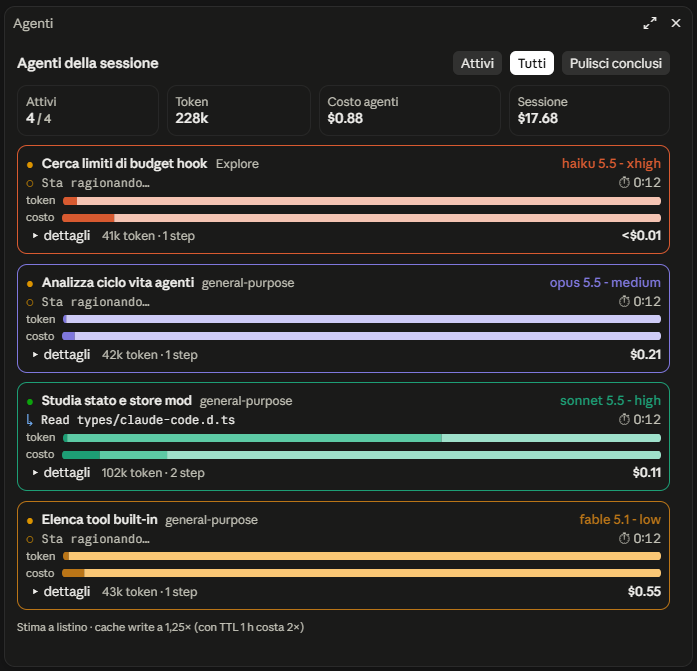

# agent-monitor

Mod di Claude Code che mostra in un pannello live gli agenti (subagenti) della sessione: modello, effort, attività, durata, token e costo stimato.



## Cosa mostra

**Totali in alto**

| Riquadro | Significato |
|---|---|
| Attivi | Agenti in esecuzione / agenti totali |
| Token | Token di tutti gli agenti |
| Costo agenti | Somma delle stime dei singoli agenti |
| Sessione | Costo reale dell'intera sessione (come `/cost`), conversazione principale compresa: per questo non è confrontabile con "Costo agenti" |

**Scheda di ogni agente attivo**

- Descrizione del compito, tipo di agente e `modello - effort`, nel colore della famiglia (viola opus, verde acqua sonnet, corallo haiku, ambra fable).
- Attività: il primo tool chiesto nell'ultimo step (`Edit src/parser.ts`), "Sta ragionando…" mentre il modello elabora, "Scrive la risposta" quando lo step non chiama tool.
- Durata dal primo avvio dell'agente: per un agente ripreso include anche le pause.
- Due barre con gli stessi quattro segmenti (input, output, cache read, cache write):
  - **token**: quanto contesto muove l'agente;
  - **costo**: dove vanno davvero i soldi (la cache read pesa molto nei token e poco nel costo).

  Sul desktop sono barre SVG continue; sul terminale usano blocchi a ottavi di cella.
- "▸ dettagli" apre i quattro contatori in cifre e gli ultimi 5 tool chiamati.

**Agenti conclusi**: una riga compatta con ✓, oppure ✗ con l'esito (Interrotto, Errore API, Rifiutato); "▸" la riapre.

**Pulsanti**

- **Attivi**: agenti in corso più gli ultimi 3 conclusi. **Tutti**: l'intera sessione.
- **Pulisci conclusi**: toglie tutti gli agenti terminati, compresi quelli falliti o di prima di un `/clear`.

**Status line**: `⚙ 3 agenti · $0.84` finché c'è almeno un agente attivo; il costo somma tutti gli agenti della sessione, conclusi compresi.

Sono elencati solo gli agenti avviati dal tool Agent dopo l'inizio della sessione (o dopo l'ultimo `/clear`); i fork interni del motore restano nascosti.

## Comando

`/agent-monitor` apre il pannello. Il pannello si apre anche da solo a ogni nuovo agente, quindi si riapre anche se lo avevi chiuso.

## Installazione

Al prompt di una sessione da terminale:

```
/plugin install agent-monitor --marketplace federicoxella-space/claude-agent-monitor
```

Da shell:

```bash
claude plugin install agent-monitor --marketplace federicoxella-space/claude-agent-monitor
```

Nell'app desktop: + accanto al prompt → Plugins → Add marketplace con `federicoxella-space/claude-agent-monitor` → Add plugin.

I moduli di hook dei plugin installati sono in early access: se la mod non parte, aggiungi a `~/.claude/settings.json`

```json
{ "env": { "CLAUDE_CODE_ENABLE_FUNCTION_HOOKS": "1" } }
```

## Note sui costi

- Stima a prezzo di listino, da una tabella fissa in `hooks/cost.ts` da aggiornare a mano per i nuovi modelli. Sconti e prezzi aziendali non sono inclusi.
- La cache write è calcolata a 1,25× l'input (TTL 5 min); con TTL 1 h il costo reale è 2×.
- Un agente con un modello che non è in tabella mostra "prezzo del modello sconosciuto" nella barra del costo ed è escluso dai totali: il totale prende un `*` e in fondo al pannello compare quanti agenti sono esclusi.
